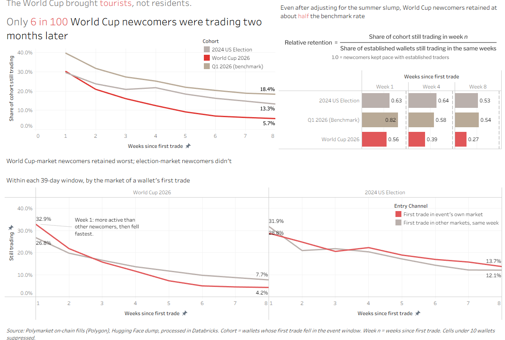
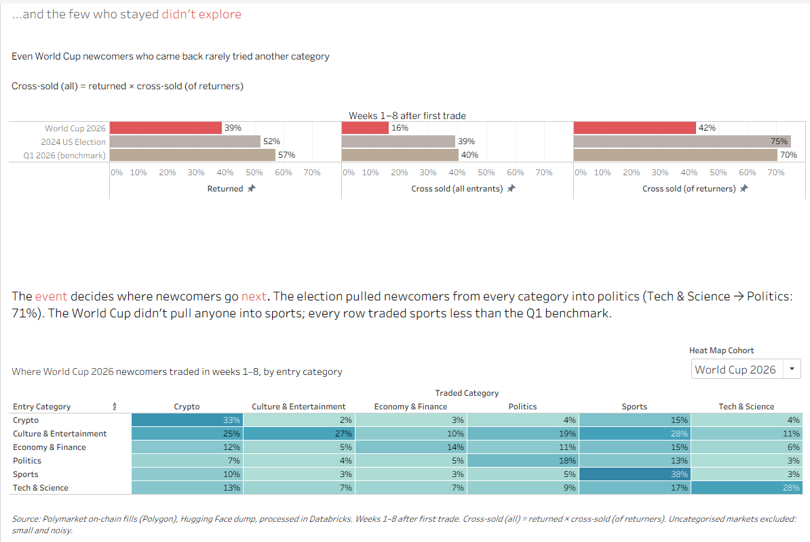
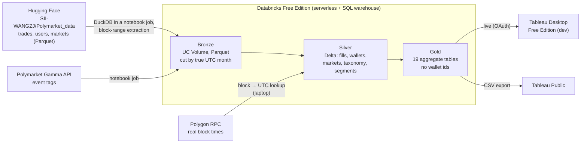

# Polymarket Player Economy

> **Tourists or residents? Did the traders Polymarket gained during the 2026 World Cup stay?**

**Dashboards (Tableau Public):** [Polymarket player economy after the World Cup](https://public.tableau.com/app/profile/ashwin.barman/viz/PolymarketplayereconomyaftertheWorldCup/Didtheystay). There are two dashboards: **Did they stay?** (retention) and **Did they explore?** (cross-sell).




An end-to-end analytics project. 3.3 billion on-chain fill rows are loaded into a Databricks lakehouse (bronze → silver → gold), tested and reconciled at each layer, and modelled into small aggregate marts for Tableau. The business question is the one a Head of Growth would ask after a record summer: were the newcomers acquired during the World Cup worth having? Did they stay, and did they cross-sell into other categories?

| Polymarket concept | iGaming / betting equivalent |
|---|---|
| Entry category of first trade | Acquisition channel / first product |
| Moving from sports to politics | Cross-sell from sportsbook to casino |
| Top-1% wallet concentration | VIP management |
| New market listing | Product launch |
| Cash traded / cash staked per trader | Turnover / handle per customer |

---

## Key findings

Three acquisition cohorts. Each is defined by the date of a wallet's first-ever fill: **World Cup 2026** (11 Jun–19 Jul 2026, 226,923 wallets), **Q1 2026** (Jan–Mar 2026, 713,066) and **2024 US election** (28 Sep–5 Nov 2024, 218,361). Retention is measured in weeks since each wallet's own first fill.

- **World Cup newcomers churned fastest.** Week-8 retention was **5.7%** for the World Cup cohort, against **18.4%** for Q1 2026 and **13.3%** for the 2024 election. In week 1 the World Cup cohort (30.2%) was level with the election cohort (29.6%). The gap opens after the first week.
- **The gap is not just the summer slowdown.** Each cohort is compared with established wallets that were active during its window, over the same calendar weeks. On that basis, relative week-8 retention is **0.27** for the World Cup cohort, against **0.53** for the election and **0.54** for Q1 2026. World Cup newcomers kept about half the benchmark rate even after the calendar adjustment.
- **Wallets that came in through a World Cup market were the least likely to stay.** Their week-8 retention was **4.2%**. Wallets that joined in the same window through any other market retained **7.7%**. The 2024 election does not show this penalty: election-market entrants retained 13.7% against 12.1% for other entrants.
- **Those who stayed seldom crossed into new categories.** Among cohort wallets that traded again in weeks 1–8, **42.4%** traded a category other than the one they entered through (37,369 of 88,199). The figure was **75.0%** for the election cohort and **70.4%** for Q1 2026. Across the whole cohort, the cross-sell rate was 16.5%, against 39.2% and 40.4%.

The figures cover all wallet segments. Retail wallets alone give the same picture: week-8 retention of 5.2% / 17.7% / 13.2%, and relative retention of 0.27 / 0.55 / 0.57. Sources: `gold.cohort_retention`, `gold.cohort_calendar_baseline` and `gold.cohort_category_transition`, and decision 41 in the [brief](docs/PROJECT_BRIEF.md#11-decision-log).

---

## Pipeline



**Scale**

| Stage | Figures |
|---|---|
| Source | `trades` 1,266,885,846 rows (45.85 GB) and `users` 2,026,673,731 rows (60.76 GB), plus `markets` 4,049,900 rows. Coverage 21 Nov 2022 – 4 Oct 2026 |
| Bronze | 102.6 GB of Parquet in a Unity Catalog Volume, loaded month by month directly from Hugging Face inside Databricks; no data passed through the laptop. The 93 logged monthly load jobs took 2 h 24 min of job time in total |
| Silver | 1,266,885,846 fills and 2,026,673,731 wallet fills (33.3 GB of Delta), 3,192,135 wallets, 1,112,116 events, 10,902,572 wallet-months. Fact load: 100 jobs, 82 min of job time |
| Gold | 19 tables, 418,228 rows. Exported as 72.2 MB of CSV; the largest table has 277,996 rows (Tableau Public's limit is 15M) |
| Compute | 60.4 DBU for the whole build, including every test and failed run (12–13 Oct 2026, from `system.billing.usage`): 52.1 DBU of serverless jobs and 8.3 DBU of SQL warehouse |

---

## Data engineering highlights

**Rebuilding time from the chain.** The dataset's own timestamps are wrong by hours in places. Where a block time was missing, the source assumed exactly 2 s per block across 100,000-block chunks, so its clock drifts and then snaps back. I built a block → UTC lookup from real Polygon block times: 59,074 anchors, one every 1,000 blocks, interpolated between them. It was validated on 500 random blocks against their exact chain times: median error 1.2 s, p99 59 s, maximum 248 s. Silver compares every fill's chain time with the source clock. The source clock is more than 7 hours off somewhere in every month from October 2024 to October 2025 except February 2025, and the worst case is **23.3 h** (July 2025). In December 2024, 53.7% of fills are off by more than an hour and 15.6% fall on the wrong UTC day. The World Cup months are within 14 s. All metrics use chain time, and bronze months are cut by the block range of each true UTC month.

**What "volume" means.** On Polymarket, "volume" counts shares matched at $1 each, not dollars paid. I checked this against `markets.volume` on December 2024: 64.9% of markets match shares matched to within 0.1%, and none match either USD leg. The project therefore keeps three measures apart:
- **notional volume** = shares matched from `trades`, each fill counted once. This is the headline figure and the reconciliation figure.
- **cash traded** = a wallet's USD on buys and sells, from `users`. It counts both sides of each match and is the basis for volume per trader and whale share.
- **cash staked** = a wallet's USD on buys only (the handle analogue).

The two source tables also count differently. `users` holds 1.85 rows per `trades` row and 2.50× its USD, because it adds one taker row per transaction.

**V2 exchange cutover completeness.** Polymarket moved to new exchange contracts on 28 Apr 2026. Whole-life shares from `trades` were compared with `markets.volume` for closed markets. After the cutover, 96.6% of 1,508,790 markets are within 1% (total ratio 1.009); before it, 92.6% of 691,844 markets are (ratio 1.010). The only shortfall is at the cutover itself, about 131M shares on markets first traded on 29–30 Apr. That is logged as a known gap.

**Wallet segmentation, not bot exclusion.** Each wallet-month is labelled market maker, high-frequency taker or retail, using fills, share of hours active and maker share (rule v1, calibrated on a threshold grid over five months). Nothing is silently dropped, and every dashboard can filter by segment. Automated wallets made 40.5% of fills in December 2024 and 82.3% in March 2026. A separate scripted-cohort flag marks 32,808 wallets. These are groups of 20 or more wallets first seen on the same day that traded an identical first-day amount.

**Tests and reconciliations.** There are 136 data-quality tests: 53 whole-layer silver, 27 per-month silver and 56 gold. All pass, and their results are published in `gold.dq_summary`.
- Silver equals bronze in all 48 months on row counts and exact integer checksums.
- New wallets per day equal an independent Spark count on all 278 days compared.
- Gold weekly totals tie back to silver. The exception is three suppressed weeks in November–December 2022, which hold 156 fills.
- The category taxonomy (Gamma tags, recurring series, slug rules) leaves 0.02% of 2025–26 notional and 0.08% of 2024 notional uncategorised.
- Cells with fewer than 10 wallets are suppressed inside gold, so the live and published versions are identical.

---

## Methodology and metric definitions

- **Cohort:** wallets whose first-ever fill falls in the cohort window. Entry category, entry channel and segment at entry (the rule applied to a wallet's first 30 days) are fixed at acquisition.
- **Retention (week n):** the share of a cohort with at least one fill in days 7n to 7n+6 after the wallet's own first fill. Only wallets whose week n lies wholly inside the data are counted. The measure is capped at week 8 for all cohorts.
- **Relative retention:** cohort retention ÷ the retention of established wallets (first seen at least 12 weeks before the window opened, and active during it) over the same calendar weeks.
- **Cross-sell:** the share of a cohort that traded, in weeks 1–8, a category other than the one it entered through.
- **Active status (weekly):** new, returning (active the previous week) or resurrected (not active the previous week).
- **Whale share:** cash traded by the top 1% of the week's active wallets.
- **Fill and notional attribution:** matched fills and notional are split half to the maker wallet and half to the taker wallet, so any split adds back to the headline.

Full definitions are in [`docs/PROJECT_BRIEF.md` §7](docs/PROJECT_BRIEF.md#7-metric-definitions-draft-finalise-after-eda) and in `gold.metric_definition`, which is built from [`sql/gold/40_metric_definition.sql`](sql/gold/40_metric_definition.sql). The cohort logic (window functions) is in [`sql/gold/20_cohort_retention.sql`](sql/gold/20_cohort_retention.sql), [`22_cohort_category_transition.sql`](sql/gold/22_cohort_category_transition.sql) and [`23_cohort_calendar_baseline.sql`](sql/gold/23_cohort_calendar_baseline.sql). Every design choice is in the [decision log](docs/PROJECT_BRIEF.md#11-decision-log), with its date and evidence.

---

## Limitations

- **A wallet is not a person.** One person can run several wallets, and Polymarket's Deposit Wallets (launched 4 May 2026) give users new addresses. Test C found no break in new-wallet counts at the launch, and at most a few hundred heavy new wallets could be migrated veterans. Wallet counts are still an approximation of people.
- **Short follow-up.** The data ends on 4 Oct 2026, about 11 weeks after the World Cup final, so retention is compared up to week 8 only. Long-run value of the World Cup cohort is not observable.
- **Activity only.** The data holds trades. Deposits, withdrawals, P&L and fee revenue are absent, so "value" means volume per trader, not revenue or lifetime value.
- **Known gaps and caveats**, all annotated on the dashboards rather than adjusted:
  - The V2 cutover on 28 Apr 2026 brought a step down in active veterans.
  - 29–30 Apr 2026 is a known shortfall.
  - Before the cutover, recurring crypto markets show more shares than `markets.volume`. This is not investigated.
  - Nov 2022 and Oct 2026 are partial months.
  - Cohorts before March 2023 are left-censored at the CLOB launch.
  - A fill within a few minutes of midnight UTC can land on the neighbouring day.
  - Segment rule v1 leaves some semi-automated wallets in retail.

---

## Repo layout

```
docs/
  PROJECT_BRIEF.md     goals, data sources, metric definitions, known issues, decision log
  SILVER_PLAN.md       silver tables, taxonomy and segment rules
  GOLD_PLAN.md         gold tables, grain, suppression
  DASHBOARD_SPEC.md    Tableau sheets, fields, calculated fields and filters
  img/                 dashboard screenshots
config/                taxonomy: Gamma tag → category map, slug rules
scripts/
  00–12_*.py           exploration and spike tests (laptop, DuckDB)
  13_load_bronze.py    submits the bronze load jobs (dbx_bronze_month.py)
  14–15_*.py           wallet-identity tests (test C and follow-ups)
  16_load_silver.py    submits the silver notebooks (dbx_silver_*.py) step by step
  17_build_gold.py     runs sql/gold/*.sql on the SQL warehouse
  18_export_gold.py    exports gold to CSV for Tableau Public
  dbx_*.py             Databricks notebooks (source format)
sql/gold/              gold layer as Databricks SQL, numbered in run order
tableau/               workbook design (.twb); extracts are never committed
```

Data lives outside the repo (`D:\polymarket-economy-data`) and is never committed.

## How to reproduce

You need Python 3.12, the Databricks CLI logged in to a workspace (`databricks auth login`, profile `DEFAULT`), a Databricks SQL warehouse, and Tableau Desktop.

1. `pip install -r requirements.txt`
2. Import the `scripts/dbx_*.py` notebooks into a workspace folder. Point the scripts at that folder with the `POLYMARKET_WORKSPACE_DIR` environment variable, e.g. `$env:POLYMARKET_WORKSPACE_DIR = "/Users/<you>/polymarket-economy"` in PowerShell.
3. Build the block-time lookup: `python scripts/06_block_times.py anchors`, then `validate`, then `months`.
4. Load bronze: `python scripts/13_load_bronze.py 2022-11 2026-10`.
5. Build silver in order: `python scripts/16_load_silver.py setup`, `wallet`, `facts 2022-11 2026-10`, `market-stats`, `gamma`, `dim-market`, `wallet-month`, `calibration`, `wallet2`, `dq`.
6. Build gold: `python scripts/17_build_gold.py run <file> …` for each file in `sql/gold/` in numeric order (00–49).
7. Export: `python scripts/18_export_gold.py`. Then open the CSVs in Tableau Public Edition and follow `docs/DASHBOARD_SPEC.md`.

Each step is resumable and logs its job or statement id, so its cost can be traced in `system.billing.usage`. The SQL warehouse id and the data folder are set at the top of the scripts. Change them for your own environment.

Source data: [SII-WANGZJ/Polymarket_data](https://huggingface.co/datasets/SII-WANGZJ/Polymarket_data) (MIT licence). All published outputs are aggregates; no table on Tableau Public carries a wallet address or id.
